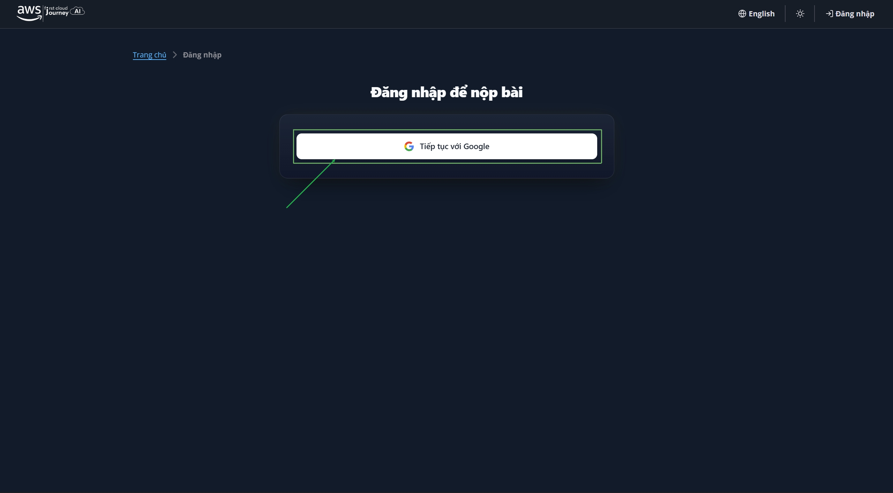
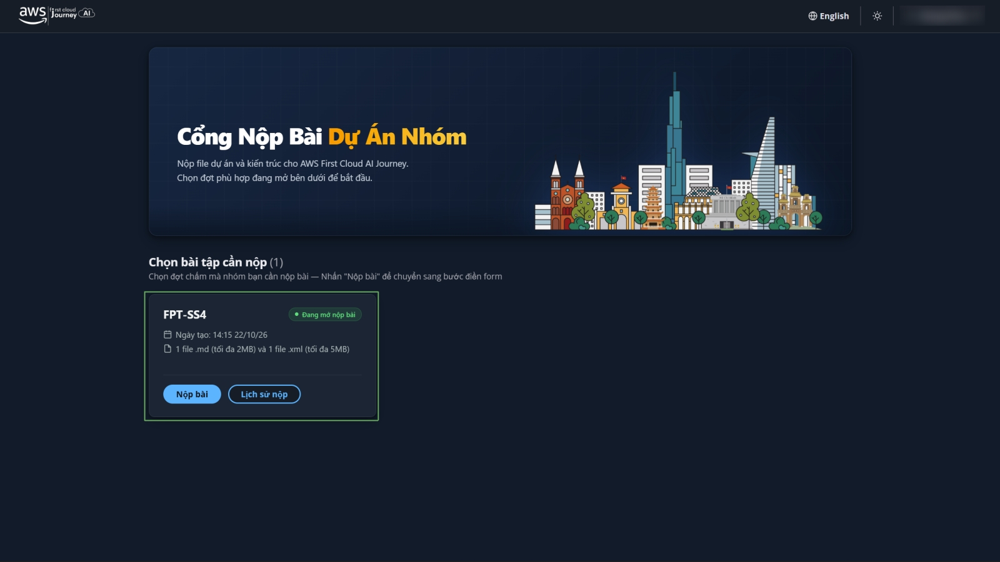
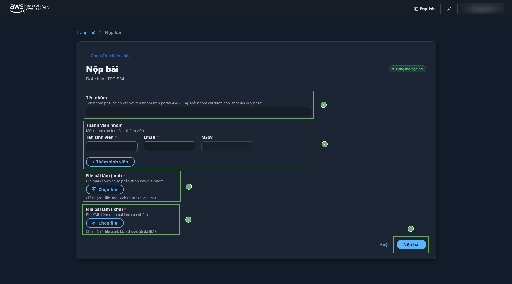
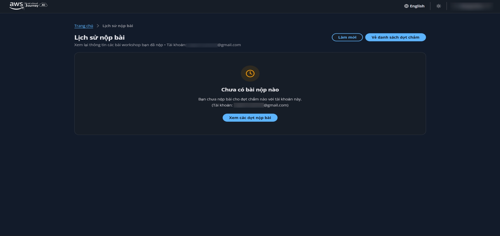

**FCAJ Submission** là hệ thống hỗ trợ chấm bài tự động cho bài Workshop và Proposal của nhóm. Hệ thống này hoạt động độc lập với FCAJ Portal và **không thay thế** việc mỗi cá nhân nộp Workshop link trên Portal.

<Callout type="info" title="Cần nhớ" icon="lightbulb" color="#DA70D6">

- Mỗi cá nhân nộp báo cáo cá nhân và Workshop link trên **FCAJ Portal**.
- Chỉ **trưởng nhóm hoặc đại diện nhóm** cần nộp thêm trên FCAJ Submission.
- Mỗi nhóm nộp **01 file `.md`** và **01 file `.xml`**.
- File `.md` tối đa **2 MB**; file `.xml` tối đa **5 MB**.
- Mỗi nhóm có tối đa **03 lần nộp**. Hãy kiểm tra kỹ trước khi bấm submit.
- Cổng nộp bài mở theo từng đợt thực tập và tự đóng theo thời gian quy định.

</Callout>

:::note[Hai hệ thống, hai nhiệm vụ]
Nộp Workshop link trên FCAJ Portal và nộp file trên FCAJ Submission là **hai việc độc lập**. Trưởng nhóm vẫn phải hoàn thành cả hai việc theo hướng dẫn.
:::

## Ai cần nộp ở đâu?

| Người thực hiện                | Hệ thống        | Việc cần làm                                                            |
| ------------------------------ | --------------- | ----------------------------------------------------------------------- |
| Mỗi cá nhân                    | FCAJ Portal     | Nộp báo cáo cá nhân và Workshop link theo template.                     |
| Trưởng nhóm hoặc đại diện nhóm | FCAJ Submission | Nộp một file `.md` summary và một file `.xml` architecture cho cả nhóm. |
| Thành viên nhóm                | FCAJ Submission | Không cần submit. Có thể đăng nhập để xem thông tin khi cần.            |

Báo cáo cá nhân và Workshop link được nộp theo [Hướng dẫn nộp Workshop](/instructions/workshop). Cấu trúc báo cáo xem tại [Nội dung bắt buộc của báo cáo và template](/project/content).

## Khi nào cổng nộp bài mở?

Đối với đợt thực tập kéo dài 3 tháng, FCAJ Submission được mở vào khoảng giữa kỳ thực tập. Ví dụ, nếu đợt thực tập bắt đầu ngày **15/5**, cổng có thể được mở ngày **15/7**.

Cổng sẽ đóng theo thời gian quy định của từng đợt. Trưởng nhóm cần chuẩn bị bản hoàn chỉnh nhất trước khi submit và không nên chờ đến gần thời điểm đóng cổng.

## Chuẩn bị trước khi nộp

### File summary `.md`

File `.md` là bản summary kỹ thuật đầy đủ của Proposal và Workshop của cả nhóm. File phải có đủ các phần sau:

- **Problem Statement**
- **Proposed Solution**
- **End-to-End Workflow**
- **Additional (Optional)**
- **Cost**

Phần **Additional (Optional)** dùng để bổ sung thông tin ngoài các phần bắt buộc. Phần này không ảnh hưởng đến điểm chấm.

:::note[Quy định về file summary]
File `.md` **không được chèn hình ảnh** và có dung lượng tối đa **2 MB**.
:::

### File architecture `.xml`

File `.xml` phải là sơ đồ **AWS Architecture** hoàn chỉnh của dự án và được export từ ứng dụng hoặc website draw.io.

- Chỉ cần thể hiện AWS Architecture.
- Sử dụng AWS icon package mới nhất.
- File có dung lượng tối đa **5 MB**.
- Không upload ảnh chụp architecture thay cho file XML export từ draw.io.

### Thông tin thành viên

Mỗi nhóm có tối thiểu **01 người** và tối đa **05 người**. Với mỗi thành viên, trưởng nhóm cần chuẩn bị:

- Họ tên.
- Mã số sinh viên.
- Email.

## Phân chia nội dung nhóm và cá nhân

Trong báo cáo Workshop trên Portal, các phần sau có thể được dùng chung giữa các thành viên trong nhóm:

- Proposal.
- Workshop.
- Blogs. Mỗi nhóm có **03 bài Blog dùng chung**.

Các phần sau phải do từng cá nhân tự viết và không được giống hoàn toàn giữa các thành viên:

- Worklog.
- Events. Mỗi cá nhân phải tham gia tối thiểu **03 sự kiện**.
- Self-Evaluation.
- Sharing and Feedback.

Quy định này áp dụng cho báo cáo cá nhân mỗi thành viên nộp trên FCAJ Portal. File `.md` và file `.xml` trên FCAJ Submission là bộ file chung của cả nhóm.

## Các bước nộp bài

<Steps>
	<Step title="Truy cập FCAJ Submission và đăng nhập">
		Mở [FCAJ Submission](https://fcajsubmission.vercel.app/) và đăng nhập bằng tài khoản Google cá nhân.

    	

    	

    	

    	Chỉ trưởng nhóm hoặc đại diện nhóm cần đăng nhập để thực hiện việc submit. Thành viên nhóm có thể đăng nhập để xem thông tin nhưng không thực hiện submit.
    </Step>
    <Step title="Chọn khu vực cần sử dụng">
    	Sau khi đăng nhập, website có hai khu vực chính:

    	- **Lịch sử nộp**: xem các lần nộp của nhóm.
    	- **Nộp bài**: tạo và submit một lần nộp mới.

    	
    </Step>
    <Step title="Điền tên nhóm và thông tin thành viên">
    	Tại biểu mẫu nộp bài:

    	1. Điền chính xác tên nhóm.
    	2. Điền họ tên, mã số sinh viên và email của từng thành viên.
    	3. Sử dụng nút **Thêm sinh viên** để bổ sung thành viên còn thiếu.
    	4. Kiểm tra số lượng thành viên trong khoảng từ 01 đến 05 người.
    </Step>
    <Step title="Upload file summary và architecture">
    	Upload hai file của nhóm:

    	- File `.md` summary kỹ thuật, tối đa 2 MB.
    	- File `.xml` AWS Architecture export từ draw.io, tối đa 5 MB.

    	
    </Step>
    <Step title="Kiểm tra và submit bài">
    	Trưởng nhóm kiểm tra lại toàn bộ thông tin và file trước khi submit. Sau khi xác nhận mọi nội dung đã chính xác, bấm nút submit để hoàn tất lần nộp.

    	:::warning[Kiểm tra trước khi submit]
    	Mỗi nhóm chỉ có tối đa **03 lần nộp**. Hãy kiểm tra kỹ tên nhóm, thông tin thành viên, nội dung file `.md`, file `.xml` và dung lượng file trước khi submit. Cổng nộp bài sẽ đóng theo thời gian quy định.
    	:::
    </Step>

</Steps>

## Kiểm tra trước khi submit

- Đã điền đúng tên nhóm.
- Đã điền đầy đủ họ tên, mã số sinh viên và email của từng thành viên.
- Số lượng thành viên từ 01 đến 05 người.
- File `.md` có đủ năm phần bắt buộc.
- File `.md` không chứa hình ảnh và không vượt quá 2 MB.
- File `.xml` là AWS Architecture hoàn chỉnh được export từ draw.io.
- File `.xml` không vượt quá 5 MB.
- Đã kiểm tra kỹ trước khi sử dụng một trong ba lần nộp.

Nếu file vượt quá dung lượng cho phép, cần giảm dung lượng file trước khi upload. Không nên submit nhiều lần chỉ vì chưa kiểm tra kỹ file hoặc thông tin nhóm.

## Theo dõi lịch sử và nộp lại

Sau khi submit, mở mục **Lịch sử nộp** để quan sát các lần nộp của nhóm.

- Hệ thống lưu lịch sử các lần nộp.
- Chỉ trưởng nhóm hoặc đại diện nhóm được nộp lại.
- Tổng số lần nộp của mỗi nhóm không vượt quá **03 lần**.
- Nếu cần nộp lại, phải hoàn thiện file trước khi sử dụng lần nộp tiếp theo.
- Cổng sẽ đóng theo thời gian quy định của từng đợt thực tập.

Tiêu chí đánh giá Proposal và Workshop được quy định tại [Proposal / Workshop](/scoring/workshop). FCAJ Submission chỉ hỗ trợ quy trình chấm bài; sinh viên vẫn phải tuân thủ đầy đủ yêu cầu của Project và barem hiện hành.
