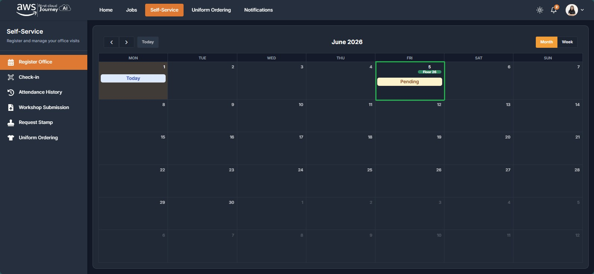
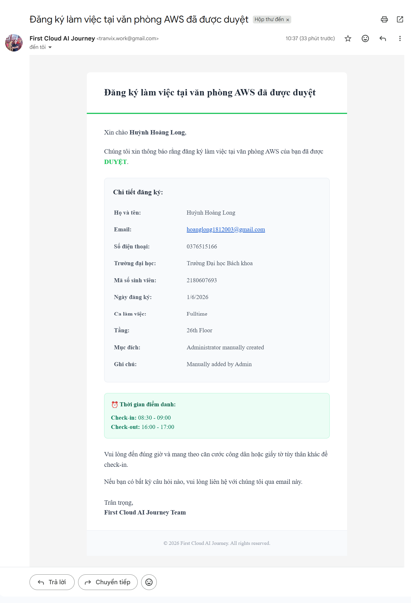

### Trường hợp 1: vẫn Pending, không được duyệt

Sau 17h của 1 ngày trước khi {{occasion}}, nếu vẫn còn trạng thái **Pending**, nghĩa là bạn **không được duyệt** {{occasion}}.

### Trường hợp 2: Approved, được duyệt

Sau 17h nếu trạng thái thành **Approved**, nghĩa là bạn đã được duyệt {{occasion}}.

:::info
Sau khi đã được duyệt {{occasion}}, kiểm tra email để xác nhận thông tin.
Trường hợp trạng thái **Approved** nhưng không có mail, vẫn {{occasion}} như trạng thái portal. Ưu tiên tuân thủ theo trạng thái trên portal.
:::

