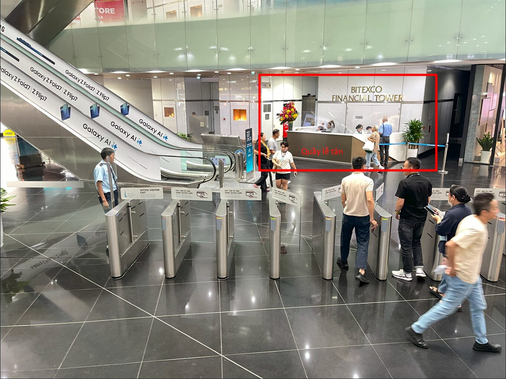
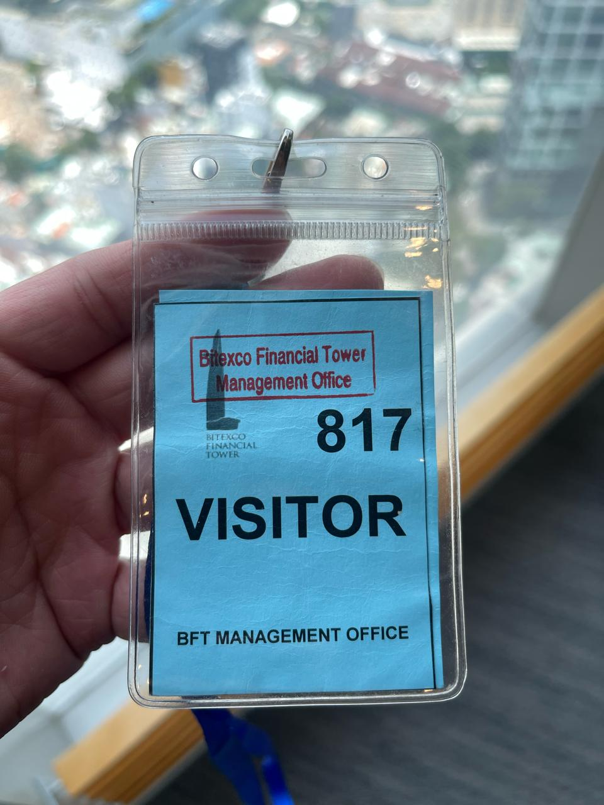
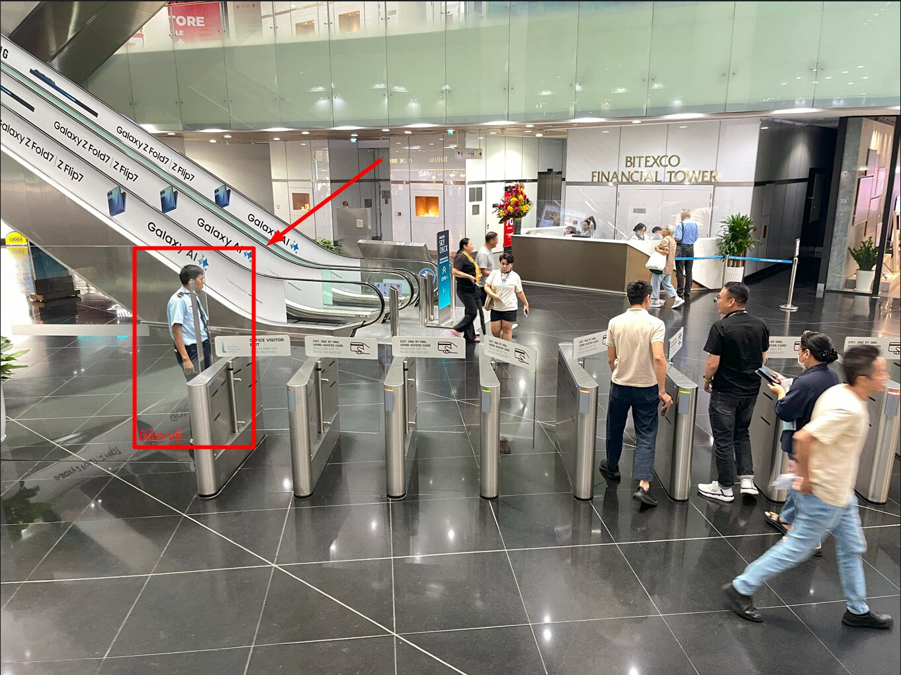
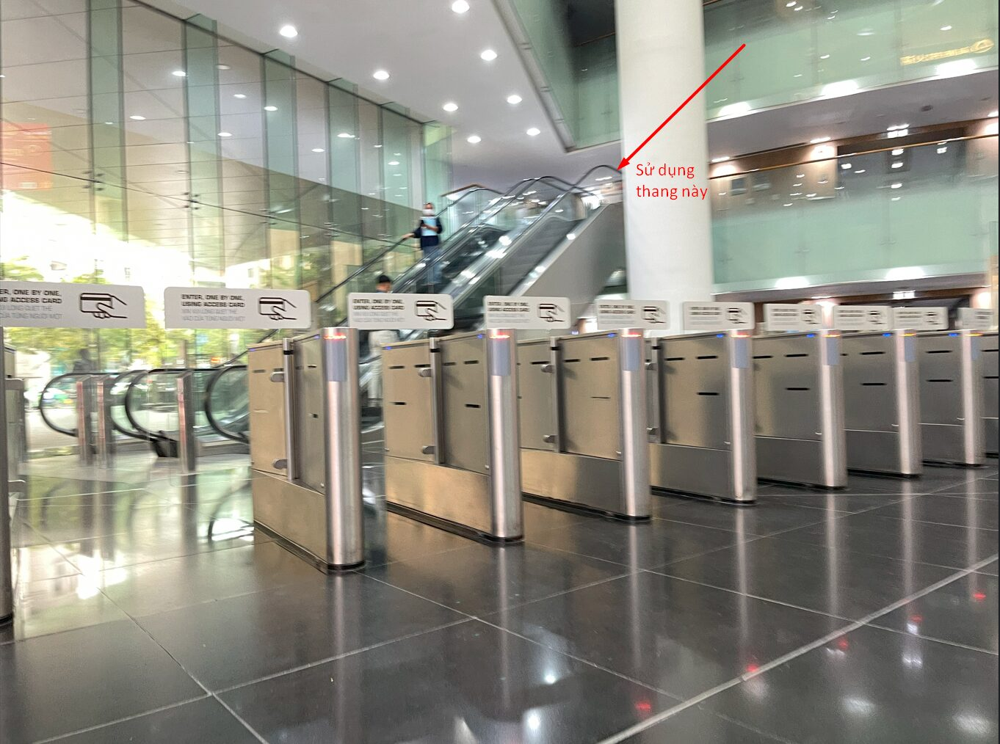
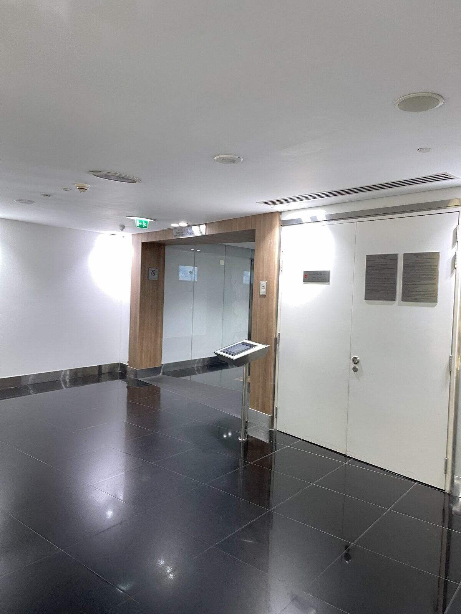
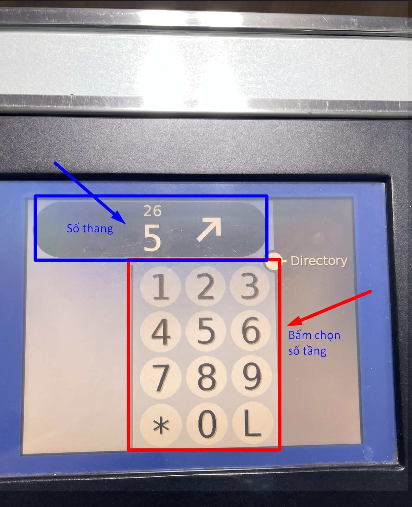

:::danger[Không đến trước giờ Event]
Khách tham dự event **không được** đến văn phòng trước khung giờ Event đã công bố. Nếu tham dự Event buổi sáng, không đến trước **08:30**. Nếu tham dự Event buổi chiều, không đến trước **13:30**.
:::

## Chuẩn bị

- Giấy tờ tùy thân: CCCD, bằng lái xe hoặc thẻ Khách tham dự event.
- Điện thoại hoặc máy tính cá nhân nếu Event yêu cầu.
- Nước uống (nước lọc hoặc nước không màu).

## Quy trình lên văn phòng

<Steps>
  <Step title="Vào sảnh Bitexco">
    Khi đến tòa nhà Bitexco, đi đến quầy lễ tân tại sảnh và **đọc họ tên** để được bảo vệ mở cửa vào.

    

    Nếu đến vì lý do khác, vui lòng mượn thẻ visitor. Cần có giấy tờ tùy thân để mượn thẻ.

    

  </Step>
  <Step title="Qua cổng an ninh">
    Đeo thẻ visitor nếu được cấp và đi đến khu vực bảo vệ trước thang cuốn để được quẹt thẻ mở cửa.

    

  </Step>
  <Step title="Đi thang cuốn lên tầng 1">
    Sau khi qua cổng, di chuyển lên tầng 1 bằng **thang cuốn**.

    

  </Step>
  <Step title="Rẽ trái đến khu thang máy">
    Sau khi lên tầng 1, rẽ trái để đến khu vực thang máy lên **tầng 26**.

    

  </Step>
  <Step title="Gọi thang máy">
    Bấm số thang trên màn hình và đợi khoảng 1 giây để màn hình hiển thị số thang máy.

    

  </Step>
  <Step title="Check-in với bảo vệ tại tầng 26">
    Đi qua cửa chính và đọc tên để bảo vệ kiểm tra danh sách Event.

    :::warning
    Nếu không thấy bảo vệ, vui lòng đợi. Sau khi check-in, đi thẳng vào phòng Event (Amazon Q) theo hướng dẫn của ban tổ chức hoặc bảo vệ.
    :::

  </Step>
  <Step title="Vào khu vực Event">
    Làm theo hướng dẫn của ban tổ chức và ngồi đúng khu vực được sắp xếp.

    :::note
    Nếu phòng chưa mở, vui lòng chờ lễ tân hoặc ban tổ chức hỗ trợ.
    :::

  </Step>
</Steps>

## Wifi tại văn phòng AWS

<include>/_shared/common/wifi.mdx</include>
